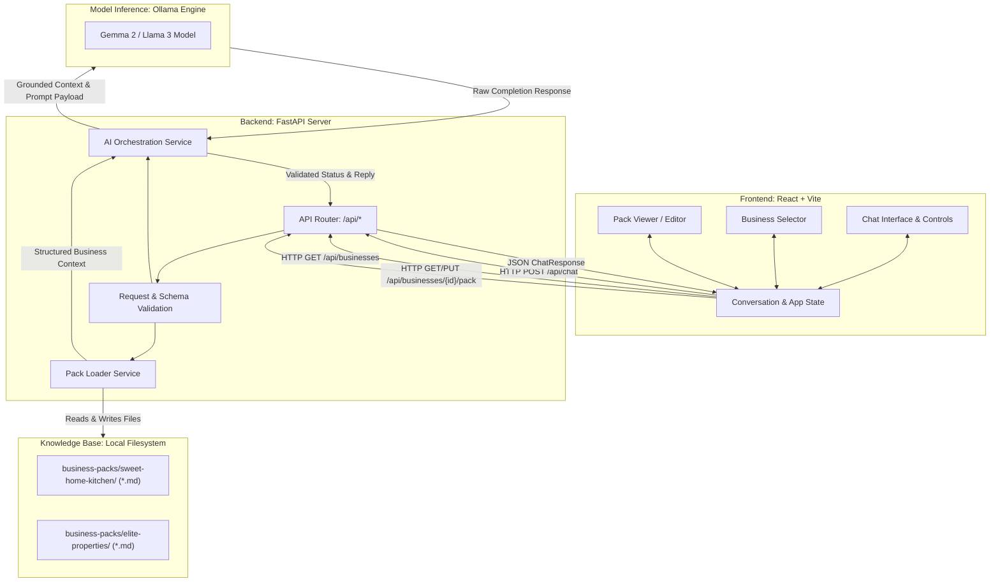
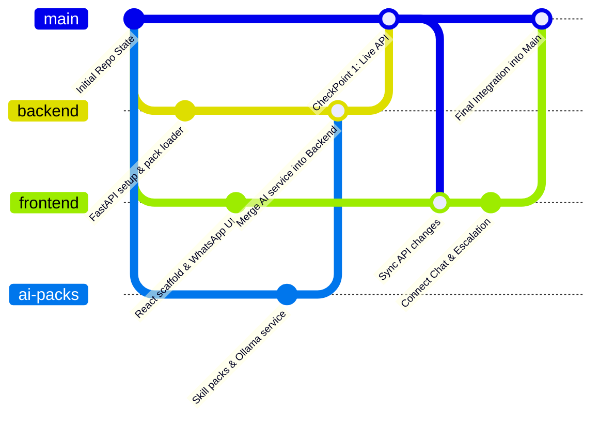

# Open Business AI – Hackathon Implementation Plan

> **Project Name:** Open Business AI  
> **Repository:** `hacktoberfest_teamrocket`  
> **Target Timeline:** 4 Hours (Hackathon Sprint)  
> **Team Size:** 3 Members  
> **Primary Goal:** A fully functional, zero-code, multi-tenant AI customer reply assistant driven by Markdown business skill packs and open-weight models.

---

## 1. Project Overview

### 1.1 Problem Statement
Micro and small businesses (bakeries, local real estate agents, boutique repair shops, independent consultancies) spend between 2 to 4 hours each day answering repetitive inquiries across messaging channels:
- What are your operating hours and location?
- How much does a custom birthday cake cost?
- Is this 2-bedroom apartment still available for inspection?
- What is your refund or booking policy?

Existing solutions fail small business owners:
1. **Rule-based chatbot builders** require complex visual flowcharts, break on minor conversational variances, and take days to configure.
2. **Enterprise AI platforms** demand expensive recurring subscriptions, API token overhead, vector database setups, and custom coding.
3. **Generic AI assistants** lack grounded business boundaries, invent non-existent pricing or inventory (hallucination), and lack a safe human hand-off mechanism when inquiries go outside defined policies.

### 1.2 Proposed Solution
**Open Business AI** is an open-source, lightweight customer reply assistant engineered for small businesses. It replaces complex database schemas and vector pipelines with human-readable **Markdown Business Skill Packs**. 

A business owner configures or updates their business profile, pricing tables, FAQs, booking policies, and ordering rules by editing standard Markdown files. A single universal backend engine parses the selected pack, grounds an open-weight language model (such as Gemma 2 2B/9B or Llama 3) strictly within that knowledge base, collects customer order details, and flags inquiries requiring human escalation.

### 1.3 Main Objective
Within a 4-hour hackathon sprint, deliver a production-grade working prototype that demonstrates:
1. **Zero-code business adaptation:** Switching between two completely different businesses (a bakery vs. a real estate agency) instantly without modifying backend logic.
2. **Strictly grounded AI responses:** Reliable answering based entirely on active Markdown skill files.
3. **Reliable escalation decisions:** Automatic detection of unknown inquiries or missing pricing details with an immediate flag for human intervention.
4. **Live skill updates:** Editing a business Markdown file immediately updates the AI's subsequent responses.

### 1.4 Core Features
- **Dynamic Skill Pack Loader:** Automatically discovers and reads Markdown files from isolated business pack directories.
- **Instant Business Switcher:** Allows clients to toggle active business context instantly in the user interface.
- **WhatsApp-Inspired Responsive Chat UI:** Familiar conversational layout showing customer inquiries, AI responses, status badges, and escalation alerts.
- **Human Escalation Engine:** Detects out-of-scope, sensitive, or missing data inquiries and returns structured status flags (`escalated`) with clear rationales.
- **Order & Booking Information Extractor:** Collects structured customer requirements (items, quantities, dates, contact details) as part of the conversation flow.
- **Live Markdown Pack Viewer & Editor:** An integrated drawer/modal allowing business owners to view and edit knowledge files directly in the browser.

### 1.5 Differentiators from Existing Chatbot Solutions
| Feature | Traditional Rule Chatbots | Enterprise LLM Platforms | Open Business AI |
| :--- | :--- | :--- | :--- |
| **Setup Mechanism** | Flowchart trees & intents | RAG, Vector DBs, Embeddings | Human-readable Markdown files |
| **Setup Time** | Days / Weeks | Hours to Days | Under 5 minutes |
| **Maintenance** | Complex logic rewiring | Re-indexing & Vector updates | Direct file text edits |
| **Model Portability** | None (Proprietary) | Cloud API Lock-in | Any open-weight model (Gemma, Llama) |
| **Code Changes to Add Business** | High | Medium | Zero (Drop folder into directory) |
| **Operational Cost** | High monthly SaaS fees | Per-token / Vector DB hosting | Minimal / Free (Local Ollama inference) |

### 1.6 Expected Final Prototype
At the end of the 4-hour build, the team will present:
1. A FastAPI backend serving endpoints for business metadata, skill pack inspection/update, and conversational reply generation.
2. An open-weight model running locally or via a local inference endpoint generating bounded answers in under 3 seconds.
3. A React + Vite single-page application showcasing:
   - A business selector dropdown (Sweet Home Kitchen vs. Elite Properties).
   - An active chat interface with rapid message exchange.
   - An escalation banner highlighting when an inquiry exceeds pack knowledge.
   - A pack editor modal demonstrating hot-reload knowledge updates.

---

## 2. System Architecture

### 2.1 Architectural Overview
The architecture is intentionally decoupled into three clean tiers:
1. **Client Tier (Frontend):** React (Vite) Single Page Application styled with responsive CSS. Manages conversational state, active business selection, chat message history, and business pack inspection.
2. **Application Tier (Backend):** Python FastAPI application providing asynchronous REST endpoints. Implements dynamic file loading, schema validation via Pydantic, and orchestration between business knowledge and the AI engine.
3. **Intelligence & Storage Tier (AI & Skill Packs):**
   - **Storage:** Local directory-based file structure containing pure Markdown documents organized by business identifier.
   - **AI Engine:** Dedicated Python integration module that merges pack knowledge with customer context and invokes an open-weight inference model via Ollama REST API.



### 2.2 End-to-End Request-Response Flow
1. **Business Initialization:** On launch, the React frontend issues `GET /api/businesses`. FastAPI queries the `business-packs/` directory and returns a list of installed business identifiers and metadata.
2. **Customer Inquiry Submission:** The user selects a business (e.g., `sweet-home-kitchen`) and sends a query (e.g., *"How much is a 1kg chocolate cake and can I order for tomorrow?"*).
3. **Context Retrieval:** FastAPI forwards the request to `pack_loader.py`. The loader reads all `.md` files in `business-packs/sweet-home-kitchen/` (profile, pricing, FAQs, ordering rules) and returns a clean, structured context string.
4. **Context Assembly:** The `ai_service.py` component combines the business knowledge with the customer's conversation history and specific output formatting rules (specifying whether the status is `success` or `escalated`).
5. **Model Inference:** The payload is posted to the local Ollama API (`POST http://localhost:11434/api/generate`).
6. **Response Parsing & Escalation Logic:** `ai_service.py` receives the model output, verifies if escalation criteria were triggered (e.g., out-of-stock items, unknown pricing, legal or medical queries), formats the response, and returns a unified JSON payload to the caller.
7. **Client UI Update:** The React app receives the response, appends the AI bubble to the chat timeline, and triggers an escalation banner if `status == "escalated"`.

---

## 3. Final Project Folder Structure

The implementation extends the existing repository structure without altering default root configuration files. Below is the full target file layout:

```text
hacktoberfest_teamrocket/
├── IMPLEMENTATION_PLAN.md                     # Master implementation roadmap (this document)
│
├── backend/                                   # FastAPI Application Root
│   ├── app/
│   │   ├── __init__.py                        # Package marker
│   │   ├── main.py                            # FastAPI entry point, CORS, lifespan events
│   │   ├── config.py                          # Environment settings (Ollama URL, pack directory)
│   │   ├── api/
│   │   │   ├── __init__.py                    # Package marker
│   │   │   ├── routes.py                      # Route definitions (/businesses, /chat, etc.)
│   │   │   └── schemas.py                     # Pydantic models for request/response validation
│   │   └── services/
│   │       ├── __init__.py                    # Package marker
│   │       ├── pack_loader.py                 # File reading, directory walking, pack aggregation
│   │       └── ai_service.py                  # Ollama connection, context assembly, response parser
│   ├── requirements.txt                       # Python dependencies (fastapi, uvicorn, httpx, pydantic)
│   └── test_backend.py                        # Standalone API validation script
│
├── frontend/                                  # React + Vite Application Root
│   ├── index.html                             # Single page HTML template
│   ├── package.json                           # NPM dependencies and run scripts
│   ├── vite.config.js                         # Vite build and dev server configuration
│   └── src/
│       ├── main.jsx                           # React DOM mount point
│       ├── App.jsx                            # Root layout, business switching state, tab views
│       ├── index.css                          # Custom styles (WhatsApp theme, reset, typography)
│       ├── components/
│       │   ├── BusinessSelector.jsx           # Business pack dropdown switcher
│       │   ├── ChatWindow.jsx                 # Conversational message history container
│       │   ├── MessageBubble.jsx              # Individual user/AI chat bubble with timestamp
│       │   ├── EscalationBanner.jsx           # Visual alert when an inquiry needs human review
│       │   └── PackEditorModal.jsx            # Drawer/modal to view and edit Markdown files
│       └── services/
│           └── api.js                         # Fetch API client wrapper for backend calls
│
└── business-packs/                            # Reusable Business Knowledge Packs
    ├── sweet-home-kitchen/                    # Demonstration Pack A: Artisan Bakery
    │   ├── profile.md                         # Business hours, address, contact, about
    │   ├── pricing_menu.md                    # Cakes, breads, pastries pricing and sizes
    │   ├── faqs.md                            # Allergen warnings, custom design notice, parking
    │   └── ordering_procedure.md              # Cut-off times, advance payment, pickup policies
    │
    └── elite-properties/                      # Demonstration Pack B: Real Estate Agency
        ├── profile.md                         # Agency license, agent names, office location
        ├── property_listings.md               # Rental and sale property specifications and prices
        ├── faqs.md                            # Security deposit, lease terms, inspection process
        └── booking_procedure.md               # KYC documents required, viewing schedule rules
```

### 3.1 File Responsibility and Dependency Matrix

| File Path | Owner | Purpose | Component Dependencies |
| :--- | :--- | :--- | :--- |
| `backend/app/main.py` | Member 1 | Application bootstrap, CORS middleware, server lifecycle. | `api/routes.py`, `config.py` |
| `backend/app/config.py` | Member 1 | Global settings (pack directory path, model name, inference host). | System environment variables |
| `backend/app/api/schemas.py` | Member 1 | Pydantic data models for request/response serialization. | Used across all routes and services |
| `backend/app/api/routes.py` | Member 1 | Declares HTTP endpoints (`/businesses`, `/chat`, `/pack`). | `pack_loader.py`, `ai_service.py` |
| `backend/app/services/pack_loader.py` | Member 1 | Reads Markdown files from disk; provides content dictionary. | `business-packs/*/*.md` |
| `backend/app/services/ai_service.py` | Member 3 | Builds prompt contexts, calls Ollama, determines escalation. | Member 1 (`schemas.py`), Ollama API |
| `backend/test_backend.py` | Member 1 | Automated sanity test for endpoints without starting frontend. | `main.py` |
| `frontend/src/services/api.js` | Member 2 | Centralized HTTP request utility with error handling. | Backend REST API contract |
| `frontend/src/App.jsx` | Member 2 | Coordinates active business, messages, and layout panels. | All frontend components |
| `frontend/src/components/ChatWindow.jsx` | Member 2 | Displays scrollable message history, typing indicators. | `MessageBubble.jsx` |
| `frontend/src/components/EscalationBanner.jsx`| Member 2 | Displays warning when inquiry requires human manager review. | Triggered by `ChatResponse.status` |
| `frontend/src/components/PackEditorModal.jsx` | Member 2 | Allows live viewing and updating of raw Markdown pack files. | `GET / PUT /api/businesses/...` |
| `business-packs/sweet-home-kitchen/*.md` | Member 3 | Curated knowledge base for bakery demo business. | Consumed by `pack_loader.py` |
| `business-packs/elite-properties/*.md` | Member 3 | Curated knowledge base for real estate demo business. | Consumed by `pack_loader.py` |

---

## 4. Division of Work Among Three Members

To guarantee parallel execution without merge conflicts or blocking bottlenecks, each team member owns a self-contained domain.

### 4.1 Member 1: Backend and API Development
- **Core Domain:** Server setup, data validation, file loader, routing, and HTTP integration.
- **Owned Files:**
  - `backend/requirements.txt`
  - `backend/app/main.py`
  - `backend/app/config.py`
  - `backend/app/api/__init__.py`
  - `backend/app/api/schemas.py`
  - `backend/app/api/routes.py`
  - `backend/app/services/pack_loader.py`
  - `backend/test_backend.py`
- **Key Deliverables:**
  1. Working FastAPI application running on `http://localhost:8000` with permissive CORS.
  2. Dynamic file-reading service that traverses `business-packs/` and aggregates Markdown text cleanly.
  3. Validated REST endpoints for business listings, pack retrieval, and message dispatch.
  4. Integration mock interface allowing Member 2 (Frontend) to test before AI model integration is finalized.

### 4.2 Member 2: Frontend and User Interface
- **Core Domain:** User experience, WhatsApp-style chat design, business selector, state management.
- **Owned Files:**
  - `frontend/package.json`
  - `frontend/vite.config.js`
  - `frontend/index.html`
  - `frontend/src/main.jsx`
  - `frontend/src/App.jsx`
  - `frontend/src/index.css`
  - `frontend/src/services/api.js`
  - `frontend/src/components/BusinessSelector.jsx`
  - `frontend/src/components/ChatWindow.jsx`
  - `frontend/src/components/MessageBubble.jsx`
  - `frontend/src/components/EscalationBanner.jsx`
  - `frontend/src/components/PackEditorModal.jsx`
- **Key Deliverables:**
  1. Fast, responsive single-page web app running on `http://localhost:5173`.
  2. Mobile-friendly WhatsApp-style conversation layout (green accent, clear bubbles, timestamps).
  3. Dynamic business selection dropdown with instant conversation reset.
  4. Real-time visual alerts for human escalation with actionable reasons.
  5. Interactive Markdown viewer and editor allowing real-time edits to the active pack.

### 4.3 Member 3: AI Integration and Business Skill Packs
- **Core Domain:** Model setup, inference orchestration, prompt assembly, escalation logic, domain knowledge files.
- **Owned Files:**
  - `backend/app/services/ai_service.py`
  - `business-packs/sweet-home-kitchen/profile.md`
  - `business-packs/sweet-home-kitchen/pricing_menu.md`
  - `business-packs/sweet-home-kitchen/faqs.md`
  - `business-packs/sweet-home-kitchen/ordering_procedure.md`
  - `business-packs/elite-properties/profile.md`
  - `business-packs/elite-properties/property_listings.md`
  - `business-packs/elite-properties/faqs.md`
  - `business-packs/elite-properties/booking_procedure.md`
- **Key Deliverables:**
  1. Validated local model instance running in Ollama (recommended: `gemma2:2b` or `llama3.2:3b` for fast inference).
  2. Context assembly engine that injects business profile and skills without cross-tenant contamination.
  3. Structured response validator that forces the model to categorize its output as either `success` or `escalated`.
  4. Two comprehensive, realistic Markdown skill packs populated with domain-specific knowledge.

### 4.4 Coordination & Hand-off Matrix

| Hand-off Point | Provider | Consumer | Required Artifact | Resolution Time |
| :--- | :--- | :--- | :--- | :--- |
| **API Contract & Schema** | Member 1 | Members 2 & 3 | Frozen request/response JSON formats (Section 9) | Hour 0:30 |
| **Model Verification** | Member 3 | Member 1 | Confirmation of working local Ollama endpoint & model name | Hour 0:45 |
| **Mock Chat API** | Member 1 | Member 2 | Working endpoint returning deterministic mock responses | Hour 1:15 |
| **Pack Content Specs** | Member 3 | Member 1 | Directory structure and file naming convention | Hour 1:30 |
| **AI Service Function** | Member 3 | Member 1 | `generate_reply(business_id, message, context)` implementation | Hour 2:15 |
| **Full System Integration** | All | All | Frontend talking to live AI backend on local network | Hour 2:45 |

---

## 5. Four-Hour Execution Timeline

```mermaid
gantt
    title 4-Hour Hackathon Execution Timeline
    dateFormat HH:mm
    axisFormat %H:%M

    section Phase 1: Setup & Contracts
    Git init & branch creation        :done, p1, 00:00, 00:20
    API contract & schema freeze      :done, p2, 00:20, 00:30
    Model download & benchmark        :active, p3, 00:00, 00:45

    section Phase 2: Parallel Build
    M1: FastAPI & Pack Loader         :b1, 00:30, 01:30
    M2: React Scaffold & WhatsApp UI  :f1, 00:30, 01:30
    M3: Skill Packs & AI Wrapper      :a1, 00:45, 01:30

    section Phase 3: Early Checkpoint
    Checkpoint 1: Mock Integration    :crit, c1, 01:30, 02:00

    section Phase 4: Core Wiring
    M1: Chat Router & AI Hookup       :b2, 02:00, 02:45
    M2: API Client & Escalation Alert :f2, 02:00, 02:45
    M3: Escalation Logic & Testing    :a2, 02:00, 02:45

    section Phase 5: Full Integration
    Checkpoint 2: End-to-End Test     :crit, c2, 02:45, 03:15
    Pack Editor Hot-Reload Feature    :b3, 03:15, 03:40

    section Phase 6: Polish & Demo
    Bug fixes & demo rehearsal        :crit, d1, 03:40, 04:00
```

### Detailed Timeline Matrix

| Time Window | Member 1 (Backend) | Member 2 (Frontend) | Member 3 (AI & Packs) | Milestone Deliverable |
| :---: | :--- | :--- | :--- | :--- |
| **0:00 – 0:30**<br>*Setup & Contracts* | - Initialize git branch `backend`<br>- Set up virtualenv & `requirements.txt`<br>- Draft `schemas.py` per contract | - Initialize git branch `frontend`<br>- Scaffold Vite project (`npm create vite@latest`)<br>- Configure layout shell | - Initialize git branch `ai-packs`<br>- Verify Ollama installed & pull `gemma2:2b`<br>- Benchmark inference latency | **API Contract Frozen**<br>Model verified locally. |
| **0:30 – 1:00**<br>*Parallel Build I* | - Build `pack_loader.py` (file scanning & markdown parsing)<br>- Create `GET /api/businesses` | - Build `index.css` (WhatsApp layout, color tokens)<br>- Build `BusinessSelector.jsx` component | - Draft `sweet-home-kitchen/` files (`profile.md`, `pricing_menu.md`)<br>- Write standalone prompt test script | **Pack Loader Working**<br>Frontend styled shell ready. |
| **1:00 – 1:30**<br>*Parallel Build II*| - Create `GET /api/businesses/{id}/pack`<br>- Create temporary mock handler for `POST /api/chat` | - Build `ChatWindow.jsx` and `MessageBubble.jsx`<br>- Implement client-side mock chat loop | - Draft `elite-properties/` files<br>- Build initial `ai_service.py` to call Ollama `/api/generate` | **Mock API Ready**<br>Skill packs drafted on disk. |
| **1:30 – 2:00**<br>*(CHECKPOINT 1)*| **Integration Checkpoint 1:**<br>- Run backend server<br>- Assist Member 2 in connecting React app to real `GET /api/businesses` and mock `POST /api/chat` | **Integration Checkpoint 1:**<br>- Connect frontend `api.js` to backend<br>- Verify business dropdown populates dynamically from filesystem | **Integration Checkpoint 1:**<br>- Validate that `pack_loader.py` reads all drafted Markdown files without errors or encoding bugs | **Milestone 1:**<br>Frontend successfully calls backend and renders live business list. |
| **2:00 – 2:45**<br>*Deep Integration* | - Integrate `ai_service.py` into `routes.py`<br>- Wire real model inference to `POST /api/chat`<br>- Add CORS & exception handlers | - Implement `EscalationBanner.jsx`<br>- Add loading spinner & disable button during request<br>- Handle error boundaries | - Refine system instructions in `ai_service.py` for structured status output<br>- Tune escalation triggers (unknown price, missing policy) | **Live AI Loop Active**<br>Chat generates model answers based on Markdown. |
| **2:45 – 3:15**<br>*(CHECKPOINT 2)*| **Integration Checkpoint 2:**<br>- Test end-to-end chat across both businesses<br>- Verify no data leakage between Sweet Home Kitchen and Elite Properties | **Integration Checkpoint 2:**<br>- Validate escalation alert appearance on UI<br>- Build `PackEditorModal.jsx` for viewing/editing files | **Integration Checkpoint 2:**<br>- Audit model answers against Markdown facts<br>- Test edge cases (unsupported items, allergen queries) | **Milestone 2:**<br>Full end-to-end working prototype with escalation working. |
| **3:15 – 3:40**<br>*Feature Completion*| - Add `PUT /api/businesses/{id}/pack` for live editing (Optional / Should-Have feature) | - Connect `PackEditorModal.jsx` to PUT endpoint<br>- Add reload feedback toast | - Perform prompt fine-tuning for multilingual queries (Spanish, Hindi, French) | **Hot-Reload Active**<br>Editing markdown live updates subsequent replies. |
| **3:40 – 4:00**<br>*Polish & Demo Run*| - Code freeze<br>- Monitor backend console logs<br>- Verify fallback scripts ready | - UI touchups, verify scroll behavior, ensure clear contrast on all displays | - Rehearse 3-minute presentation script<br>- Pre-seed demo prompts in quick-copy scratchpad | **Code Freeze**<br>Ready for final judging. |

---

## 6. Backend Implementation Plan

### 6.1 Step-by-Step Implementation Sequence
1. **Environment Setup:** Install `fastapi`, `uvicorn`, `httpx`, `pydantic`.
2. **Configuration (`config.py`):** Define filesystem paths (`BASE_DIR`, `PACKS_DIR`) and inference configuration (`OLLAMA_BASE_URL="http://localhost:11434"`, `MODEL_NAME="gemma2:2b"`).
3. **Data Schemas (`schemas.py`):** Define robust Pydantic schemas for all payloads to guarantee contract consistency.
4. **Pack Loader Service (`pack_loader.py`):**
   - Function `list_available_businesses()`: Scans `business-packs/` and inspects `profile.md` in each subfolder to extract display name and description.
   - Function `load_business_pack(business_id: str)`: Reads all `.md` files in the folder, returning an aggregated dictionary of filenames to file contents.
   - Function `update_business_pack_file(business_id: str, filename: str, content: str)`: Safely writes updated Markdown back to disk.
5. **Route Controllers (`routes.py`):** Expose standard REST endpoints.
6. **AI Service Hookup (`ai_service.py`):** Call Member 3's inference module within the `POST /api/chat` route.
7. **Error and CORS Handling:** Configure `CORSMiddleware` with `allow_origins=["*"]` and register global HTTP exception handlers.

### 6.2 Endpoint Specifications

#### 1. List Available Businesses
- **Route:** `GET /api/businesses`
- **Description:** Returns an array of available business packs found in the local filesystem.
- **Response Format (`200 OK`):**
```json
[
  {
    "business_id": "sweet-home-kitchen",
    "name": "Sweet Home Kitchen",
    "category": "Bakery & Confectionery",
    "description": "Artisan bakery specializing in custom celebration cakes, sourdough bread, and pastries."
  },
  {
    "business_id": "elite-properties",
    "name": "Elite Properties",
    "category": "Real Estate Agency",
    "description": "Boutique property consultancy offering residential rentals and commercial investments."
  }
]
```

#### 2. Get Business Pack Details
- **Route:** `GET /api/businesses/{business_id}/pack`
- **Description:** Returns all Markdown file contents for a specific business pack.
- **Response Format (`200 OK`):**
```json
{
  "business_id": "sweet-home-kitchen",
  "files": {
    "profile.md": "# Sweet Home Kitchen\n\nOperating hours: 8am - 6pm...",
    "pricing_menu.md": "# Menu & Pricing\n\n- Chocolate Truffle: $35/kg...",
    "faqs.md": "# Frequently Asked Questions\n\nQ: Are you nut-free?...",
    "ordering_procedure.md": "# Ordering\n\nOrders must be placed 24h prior..."
  }
}
```

#### 3. Send Customer Message (Chat)
- **Route:** `POST /api/chat`
- **Description:** Accepts a customer inquiry, binds it to the specified business pack context, runs model inference, and returns a grounded reply with escalation flags.
- **Request Format:**
```json
{
  "business_id": "sweet-home-kitchen",
  "message": "Can I get a 1kg chocolate truffle cake tomorrow morning?",
  "conversation_history": [
    {
      "sender": "customer",
      "text": "Hello, do you make birthday cakes?"
    },
    {
      "sender": "assistant",
      "text": "Hello! Yes, we bake custom celebration cakes daily. What flavor are you looking for?"
    }
  ]
}
```
- **Response Format (`200 OK`):**
```json
{
  "reply": "Yes! Our 1kg Chocolate Truffle cake is available for $35. As per our policy, orders require at least 24 hours notice. Could you please confirm your name and preferred pickup time tomorrow morning?",
  "status": "success",
  "business_id": "sweet-home-kitchen",
  "escalation_reason": null
}
```
- **Escalated Response Format (`200 OK` with Flag):**
```json
{
  "reply": "I'd love to help with a 5-tier wedding cake, but custom event catering over 3 tiers requires direct consultation with our head pastry chef. I have escalated this to our team.",
  "status": "escalated",
  "business_id": "sweet-home-kitchen",
  "escalation_reason": "Custom wedding cake inquiry exceeds standard pricing menu limits."
}
```

#### 4. Update Business Pack File (Should-Have / Optional)
- **Route:** `PUT /api/businesses/{business_id}/pack`
- **Description:** Updates the content of a specific Markdown file within the business pack.
- **Request Format:**
```json
{
  "filename": "pricing_menu.md",
  "content": "# Menu & Pricing\n\n- Chocolate Truffle: $40/kg (Updated)\n- Red Velvet: $42/kg..."
}
```
- **Response Format (`200 OK`):**
```json
{
  "success": true,
  "message": "File 'pricing_menu.md' updated successfully for 'sweet-home-kitchen'."
}
```

---

## 7. Frontend Implementation Plan

### 7.1 Architecture and Layout
The frontend provides a distraction-free, modern interface inspired by desktop WhatsApp Web and customer support desks.

```text
+-----------------------------------------------------------------------------------+
|  [Logo] Open Business AI        | Active: [Sweet Home Kitchen  v] | [Edit Pack]   |
+---------------------------------+-------------------------------------------------+
|                                 |                                                 |
|  BUSINESS PROFILE CARD          |  CHAT WINDOW                                    |
|  - Name: Sweet Home Kitchen     |                                                 |
|  - Category: Bakery             |  [Customer] Hi, do you have chocolate cake?    |
|  - Hours: 08:00 - 18:00         |                                                 |
|  - Pack: 4 Markdown files       |  [AI Assistant] Yes! We offer 1kg Chocolate     |
|                                 |                 Truffle for $35.                |
|  -----------------------------  |                                                 |
|  STATUS & TELEMETRY             |  [!] Escalation Banner (Hidden until triggered) |
|  - Model: Gemma 2 2B (Local)    |                                                 |
|  - Latency: 1.8s                |  ---------------------------------------------  |
|  - Escalation: 0 Active         |  [ Type your message here...           ] [Send] |
+---------------------------------+-------------------------------------------------+
```

### 7.2 Component Breakdown
1. **`App.jsx`:**
   - Holds primary state: `businesses` (array), `selectedBusiness` (string), `messages` (array), `isLoading` (boolean), `isEditorOpen` (boolean), `activeEscalation` (null or string).
   - Fetches business list on initial mount via `GET /api/businesses`.
   - Clears message history whenever `selectedBusiness` changes to ensure clean tenant testing.
2. **`BusinessSelector.jsx`:**
   - Dropdown at the header showing all discovered business packs.
   - Triggers clean context switch across the entire app.
3. **`ChatWindow.jsx` & `MessageBubble.jsx`:**
   - Displays conversational scroll area with auto-scrolling to the latest message.
   - Visual distinction between `customer` (green bubble, aligned right) and `assistant` (white/gray bubble, aligned left).
   - Shows loading skeleton/typing indicator while waiting for inference.
4. **`EscalationBanner.jsx`:**
   - Prominently styled alert banner (amber/red badge with warning icon) displayed directly above the input box or at the message footer when `status === "escalated"`.
   - Displays the specific `escalation_reason` returned by the backend.
5. **`PackEditorModal.jsx`:**
   - Slide-over drawer or modal tabbed by file (`profile.md`, `pricing_menu.md`, `faqs.md`, `ordering_procedure.md`).
   - Renders a plain text editor with a **Save & Apply** button.
   - When saved, fires `PUT /api/businesses/{id}/pack` and refreshes local pack state.
6. **`services/api.js`:**
   - Encapsulates native `fetch` requests with standard timeout configuration (10 seconds) and consistent error throwing.

---

## 8. AI and Skill Pack Implementation Plan

### 8.1 Markdown Knowledge Base Organization
Each business pack is a directory containing plain UTF-8 Markdown documents. The system enforces strict separation of concerns across files:

```text
business-packs/sweet-home-kitchen/
├── profile.md              # Identity: Address, phone, operating hours, delivery radius
├── pricing_menu.md         # Products: Item names, description, sizes, prices, add-on costs
├── faqs.md                 # Rules: Dietary/allergen info, lead time, cancelation policy
└── ordering_procedure.md   # Workflow: Required customer details (name, date, payment terms)
```

### 8.2 Demonstration Business Packs

#### Business Pack A: Sweet Home Kitchen (Artisan Bakery)
- **`profile.md`:** Open Tuesday–Sunday, 8:00 AM to 6:00 PM. Located at 42 Maple Street. Pickup in-store or local courier within 5 miles ($5 delivery fee).
- **`pricing_menu.md`:** 
  - Belgian Chocolate Truffle Cake: 1kg ($35), 2kg ($65)
  - Classic Vanilla Bean Cake: 1kg ($30), 2kg ($55)
  - Artisanal Sourdough Loaf: $8
  - Butter Croissant Box (6 pieces): $18
- **`faqs.md`:** All products made in a facility handling nuts, dairy, and gluten. Gluten-free cakes require 48 hours advance booking. Orders over $100 require a 50% non-refundable deposit.
- **`ordering_procedure.md`:** Customer must provide: (1) item name and size, (2) pickup/delivery date and time, (3) recipient name and phone number. Orders require minimum 24-hour lead time.

#### Business Pack B: Elite Properties (Boutique Real Estate Agency)
- **`profile.md`:** Licensed agency located at Suite 10, Downtown Financial Center. Working hours: Monday–Friday, 9:00 AM to 5:00 PM. Agent contact: inspection@eliteproperties.demo.
- **`property_listings.md`:**
  - *Oakwood Residence #4B:* 2 Bedroom, 2 Bath apartment, $2,400/month. Available immediately. Parking included. Pets considered on application.
  - *Harbor View Villa #12:* 4 Bedroom luxury waterfront home, $1,250,000 for sale. 3,200 sqft, private dock.
  - *High Street Retail Unit:* 850 sqft commercial space, $3,800/month. Ideal for boutique or coffee shop.
- **`faqs.md`:** Standard residential lease is 12 months. Security deposit equals 6 weeks' rent. Utilities are not included in advertised rent. No subletting allowed.
- **`booking_procedure.md`:** In-person viewings require 24 hours pre-registration with photo ID and proof of employment/income. Viewings run Wednesdays and Saturdays only.

### 8.3 Context Assembly & Guardrail Mechanism
The `ai_service.py` component performs runtime context assembly:
1. **Dynamic Ingestion:** Reads the current Markdown files from the active business folder.
2. **Context Compilation:** Prepares a unified grounding context string, prefixing each section with clear domain markers (e.g., `=== BUSINESS PROFILE ===`, `=== PRODUCTS & PRICING ===`).
3. **Guardrail Directives:**
   - The assistant must act strictly as an official representative of the designated business.
   - The assistant is forbidden from referencing products, prices, or policies not explicitly contained in the provided Markdown context.
   - If a customer asks about an unlisted service, unavailable date, or custom request outside the text, the assistant must return an escalation flag.
   - If an order or booking inquiry is underway, the assistant must systematically ask for the missing details defined in `ordering_procedure.md` or `booking_procedure.md`.
4. **Structured Decision Parsing:** The service instructs the model to produce output containing a clear demarcation between the conversational text and the status classification (`status: success` vs `status: escalated` with reason). The parser extracts these components and converts them into the standard `ChatResponse` model.
5. **Cross-Tenant Isolation:** Context is built on demand per request. No conversation or business knowledge is cached globally across tenants, eliminating information leakage when switching businesses.

---

## 9. API Integration Contract

This contract represents the authoritative agreement between Member 1 (Backend), Member 2 (Frontend), and Member 3 (AI/Skill Packs).

### 9.1 Data Types & Models

```json
// BusinessItem
{
  "business_id": "string (lowercase, alphanumeric with hyphens)",
  "name": "string",
  "category": "string",
  "description": "string"
}

// ChatMessage
{
  "sender": "string ('customer' | 'assistant')",
  "text": "string"
}

// ChatRequest
{
  "business_id": "string",
  "message": "string (non-empty)",
  "conversation_history": [ "ChatMessage" ]
}

// ChatResponse
{
  "reply": "string",
  "status": "string ('success' | 'escalated')",
  "business_id": "string",
  "escalation_reason": "string | null"
}

// BusinessPackResponse
{
  "business_id": "string",
  "files": {
    "filename.md": "string (file content)"
  }
}

// UpdateFileRequest
{
  "filename": "string",
  "content": "string"
}
```

### 9.2 Error Response Format
All errors return standard HTTP error codes (`400`, `404`, `500`, `503`) with a consistent JSON body:
```json
{
  "detail": "Descriptive explanation of the error."
}
```

### 9.3 Internal Python Interface (Member 1 <-> Member 3)
In `backend/app/services/ai_service.py`, Member 3 exposes a single asynchronous function consumed by Member 1 in `routes.py`:

```python
async def generate_business_reply(
    business_id: str,
    customer_message: str,
    conversation_history: list[dict],
    pack_context: dict[str, str]
) -> dict:
    """
    Executes inference against the active model.
    
    Returns:
        dict matching the ChatResponse schema:
        {
            "reply": str,
            "status": "success" | "escalated",
            "business_id": business_id,
            "escalation_reason": str | None
        }
    """
```

---

## 10. Testing and Quality Assurance

### Practical Test Matrix

| Test ID | Test Scenario | Execution Step | Expected Result | Pass Criteria |
| :---: | :--- | :--- | :--- | :--- |
| **TC-01** | Backend Startup | Run `uvicorn app.main:app` | Server starts on `http://localhost:8000` without syntax errors | HTTP 200 on `/docs` |
| **TC-02** | Business Pack Discovery | `GET /api/businesses` | Returns 2 items (`sweet-home-kitchen`, `elite-properties`) | Valid JSON array of length 2 |
| **TC-03** | Bakery Menu Inquiry | Ask *"What cakes do you have and how much are they?"* | Reply lists Chocolate Truffle ($35) and Vanilla Bean ($30) | Correct pricing matching `pricing_menu.md` |
| **TC-04** | Order Detail Gathering | Ask *"I want to order a 1kg chocolate cake for Saturday."* | Reply acknowledges cake and asks for customer name & pickup time | Follows `ordering_procedure.md` rules |
| **TC-05** | Unknown Inquiry Escalation | Ask *"Do you make gluten-free vegan sushi cakes?"* | Reply states item is unlisted; `status` is `escalated` | UI displays amber Escalation Banner |
| **TC-06** | Real Estate Switch | Switch dropdown to `elite-properties` | Previous bakery chat clears; ready for property inquiry | Clean slate, active ID is `elite-properties` |
| **TC-07** | Rental Listing Inquiry | Ask *"What is the rent for the 2-bedroom at Oakwood?"* | Reply quotes $2,400/month with parking included | Exactly matches `property_listings.md` |
| **TC-08** | Isolation Verification | Ask Elite Properties: *"Can I buy a chocolate croissant?"* | Assistant states this is a real estate agency and cannot assist | **Zero** mention of Sweet Home Kitchen |
| **TC-09** | Live Markdown Hot-Reload | Edit `pricing_menu.md` (change cake price to $50), save, re-ask | Subsequent chat reflects $50 price | Knowledge dynamically reloaded without restart |
| **TC-10** | Multilingual Query | Ask in Spanish: *"¿Cuánto cuesta el pastel de chocolate?"* | Assistant replies in Spanish quoting correct price ($35/$50) | Correct language matching without hallucination |
| **TC-11** | Model Fallback / Timeout | Simulate offline Ollama server | Frontend displays clear error banner: *"AI inference unavailable"* | Graceful UI failure without crash |

---

## 11. Git and Team Collaboration

To prevent code clobbering during a rapid 4-hour window, the team adopts a strict 3-branch isolation strategy.



### 11.1 Branch Structure
1. `main`: Protected integration branch. Code here must be stable and verified.
2. `backend`: Owned exclusively by Member 1.
3. `frontend`: Owned exclusively by Member 2.
4. `ai-packs`: Owned exclusively by Member 3.

### 11.2 Collaboration Rules
1. **No direct pushes to `main`:** All code lands on feature branches first.
2. **Scheduled Sync Windows:**
   - **T+0:30:** Initial branch checkout.
   - **T+1:30:** Member 3 merges `ai-packs` into `backend` to deliver `ai_service.py`.
   - **T+2:45:** Member 1 merges `backend` into `main`; Member 2 pulls `main` into `frontend`.
   - **T+3:30:** Final merge of `frontend` into `main`.
3. **Merge Conflict Protocol:** Because folder ownership is strictly segregated (`backend/`, `frontend/`, `business-packs/`), merge conflicts will be near-zero. If a conflict occurs on root files, all members pause for a 2-minute verbal resolution.

---

## 12. Risks and Backup Strategies

| Risk Description | Probability | Impact | Preventive Measure | Practical Fallback Strategy |
| :--- | :---: | :---: | :--- | :--- |
| **Model download too slow on hackathon Wi-Fi** | High | Critical | Pull model immediately at 0:00 (`gemma2:2b` is ~1.6 GB). | **Fallback:** Use an existing local model already cached on the machine, or switch `ai_service.py` to use a free fast open-weight inference endpoint (e.g., Groq API running Llama-3-8B / Gemma 2 with zero code redesign). |
| **GPU / RAM OOM or crash** | Medium | High | Use the smallest capable quantized open-weight model (`gemma2:2b` or `llama3.2:1b`). | **Fallback:** Run Ollama in CPU mode (`OLLAMA_NUM_GPU=0`) or fall back to an external inference endpoint. |
| **Inference latency exceeds 5 seconds** | Medium | Medium | Restrict generation max tokens to 150; keep Markdown context concise. | **Fallback:** Truncate prompt context to only the relevant Markdown files instead of all 4 files. |
| **Model invents details outside Markdown** | Medium | High | Include explicit negative constraints in system prompt. | **Fallback:** Add post-inference keyword verification in `ai_service.py` to flag answers containing numbers not in the text. |
| **CORS / Network connection failure** | Low | High | Set `allow_origins=["*"]` on FastAPI from minute 1. | **Fallback:** Configure Vite proxy in `vite.config.js` to forward `/api` requests to `http://localhost:8000`. |
| **Time runs short for Pack Editor** | Medium | Low | Feature is marked as **Should-Have**; core demo works without it. | **Fallback:** Show hot-reload by editing the Markdown file directly in VS Code / IDE during the demo. |

---

## 13. Priority Classification

### 13.1 Must-Have (P0 – MVP Minimum)
*Must be working 100% by T+3:00 to qualify for presentation:*
- [x] Dynamic filesystem loading of business packs.
- [x] Functional FastAPI server (`/businesses`, `/chat`).
- [x] Real-time inference using an open-weight model.
- [x] Two distinct, fully realized demo packs (Bakery and Real Estate).
- [x] Instant business switching without server restart.
- [x] Automatic human escalation flag (`status: "escalated"`).
- [x] Responsive WhatsApp-inspired chat interface in React.
- [x] Clean separation of tenant data (zero cross-contamination).

### 13.2 Should-Have (P1 – Polish & Differentiator)
*To be implemented between T+3:00 and T+3:40 if P0 is stable:*
- [ ] In-browser Markdown Pack Viewer & Editor modal (`PUT /api/.../pack`).
- [ ] Order detail extraction badge (highlighting customer order items).
- [ ] Multilingual response verification (handling non-English queries).
- [ ] Visual telemetry chips (showing model name and inference latency).

### 13.3 Future Scope (P2 – Post-Hackathon Roadmap)
*Mentioned during the presentation pitch as next milestones:*
- Multi-channel connectors: Direct WhatsApp Cloud API & Telegram Bot webhooks.
- Community Pack Marketplace: Downloadable industry packs (Dental Clinics, Auto Repair, Fitness Coaches).
- Persistent Conversation Storage: SQLite / PostgreSQL conversation history.
- Voice Reply Integration: Speech-to-text input and text-to-speech audio notes.
- Business Owner Analytics: Dashboard tracking top customer questions and frequent escalation triggers.

---

## 14. Final Demo Plan (3-Minute Presentation)

A tightly choreographed live demonstration proving real business value and technical ingenuity to the judges.

### Timed Script & Action Sequence

| Timestamp | Presenter Action | Live Screen Display | What it Proves to the Judges |
| :---: | :--- | :--- | :--- |
| **0:00 – 0:30** | **Pitch Problem:** Explain how small business owners lose hours daily to repetitive messaging and how existing chatbots are too complex or hallucinate. | Project overview slide / clean app launch screen. | Identifies a massive real-world market need and clearly scopes the hackathon solution. |
| **0:30 – 1:00** | **Demo 1: Bakery Menu & Order:** Select *Sweet Home Kitchen*. Ask: *"Hi, do you have chocolate cake available for tomorrow afternoon?"* | Chat shows AI replying with exact pricing ($35) and politely requesting the customer's name and pickup time. | Proves that the AI is grounded in the Markdown menu and proactively drives business ordering procedures. |
| **1:00 – 1:30** | **Demo 2: Human Escalation:** Ask: *"Can you make a 5-tier suspended chandelier wedding cake for 300 guests?"* | AI politely explains custom multi-tier orders require chef review. **Amber Escalation Banner** appears on UI. | Shows safety and reliability. The AI does not hallucinate custom prices; it safely hands off to human staff. |
| **1:30 – 2:00** | **Demo 3: Zero-Code Tenant Switch:** Switch dropdown to *Elite Properties*. Ask: *"What 2-bedroom rentals do you currently have?"* | Previous chat clears. AI lists Oakwood Residence for $2,400/mo. | Proves zero-code multi-tenancy. One universal engine completely changes industry context via Markdown files alone. |
| **2:00 – 2:30** | **Demo 4: Live Hot-Reload:** Open the built-in Pack Editor (or edit `pricing_menu.md` live). Change chocolate cake from $35 to **$50**. Click Save. Re-ask cake price. | AI immediately quotes the new **$50** price in the very next message bubble. | **The "Wow" Factor.** Proves knowledge is truly file-driven and dynamically reloaded with zero downtime or retraining. |
| **2:30 – 3:00** | **Conclusion & Roadmap:** Summarize: Fully open-source, local open-weight model, zero recurring token costs, ready for WhatsApp deployment. | Architecture slide / GitHub repository view. | Confirms completion of all hackathon objectives and solid technical execution. |

---

## 15. Final Completion Checklist

Use this checklist to verify presentation readiness during the final 20 minutes (T+3:40 – T+4:00):

- [ ] **Infrastructure Check:**
  - [ ] FastAPI backend running smoothly on `http://localhost:8000`.
  - [ ] React frontend running on `http://localhost:5173`.
  - [ ] Ollama service responding with sub-3-second latency.
- [ ] **Business Pack Verification:**
  - [ ] `business-packs/sweet-home-kitchen/` contains all 4 `.md` files.
  - [ ] `business-packs/elite-properties/` contains all 4 `.md` files.
  - [ ] No syntax or encoding errors in any Markdown file.
- [ ] **Functional Verification:**
  - [ ] Switching businesses in the dropdown triggers a clean conversational reset.
  - [ ] Pricing inquiry returns exact figures from the active pack.
  - [ ] Order procedure asks for missing customer information.
  - [ ] Unknown inquiry cleanly sets `status: "escalated"` and renders the alert banner.
  - [ ] Elite Properties answers without leaking bakery terms (croissant, cake, bakery).
  - [ ] Modifying a Markdown file updates subsequent AI responses.
- [ ] **Presentation Polish:**
  - [ ] Browser window zoomed to 110% for projector / screen share visibility.
  - [ ] Quick-copy scratchpad with test questions prepared to prevent typing delays.
  - [ ] Backend terminal visible in split screen to show live request logs to technical judges.
